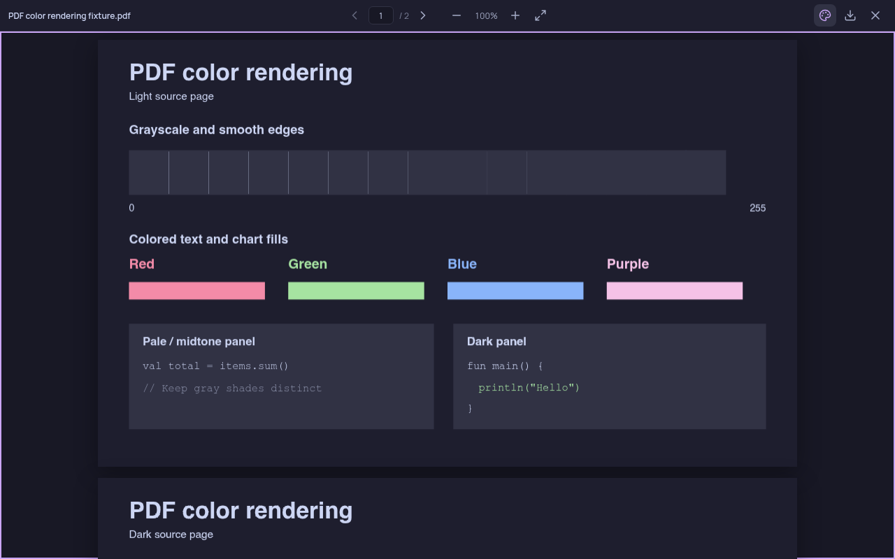
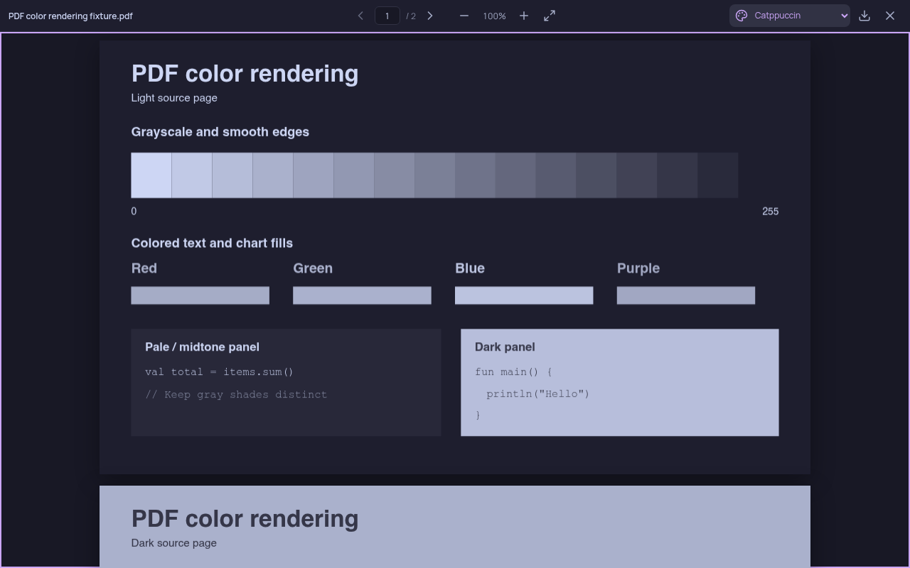
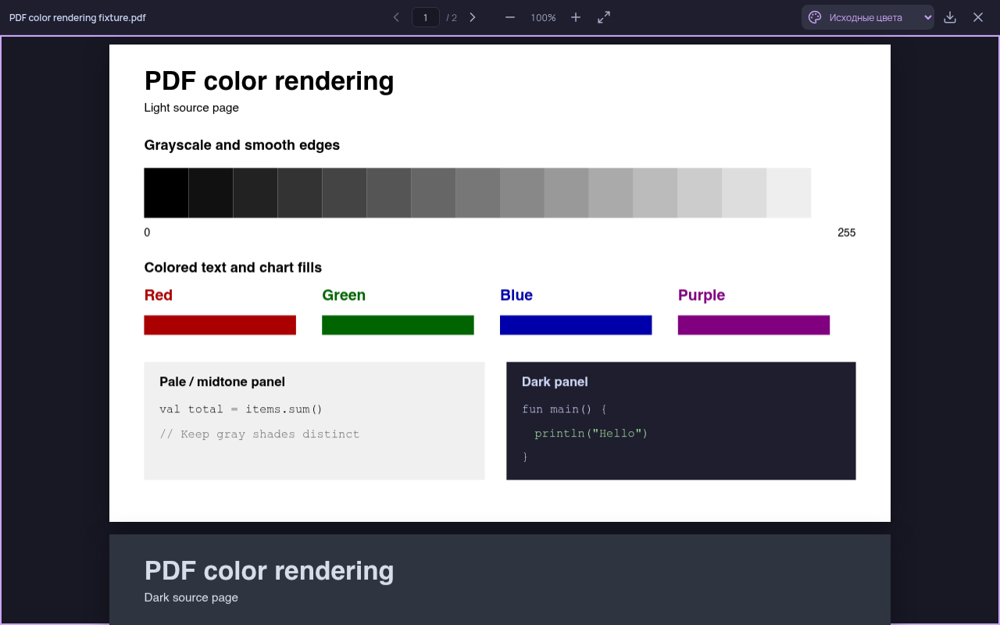
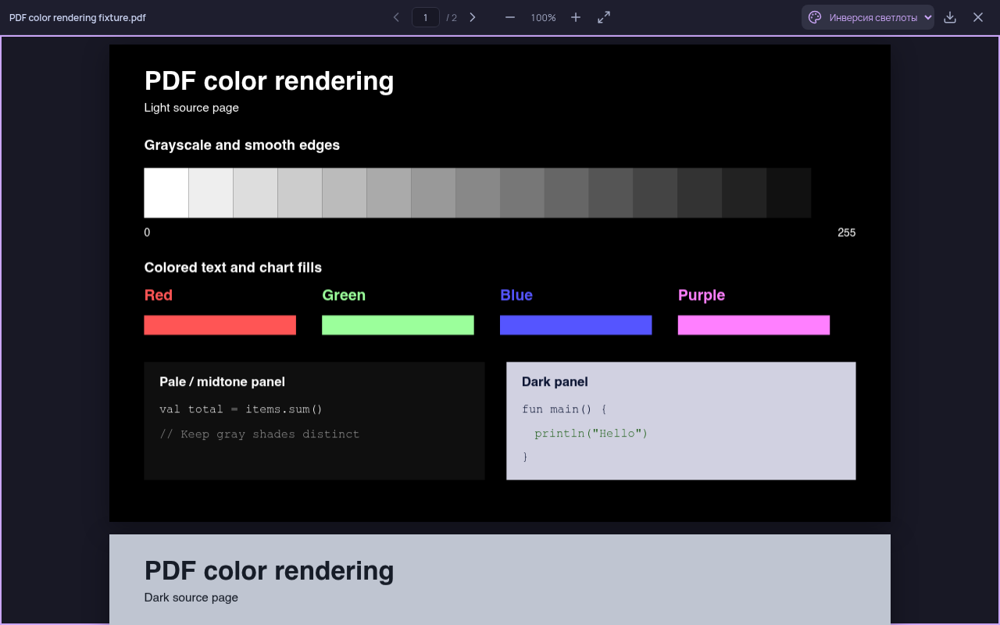

# PDF color rendering

The previous renderer inferred paper regions and replaced ink with Catppuccin
accents. Broad gray shapes could all become the same surface color. In the test
document below, this erased the grayscale steps and added thin bright boundaries.

The replacement follows two of [Okular's accessibility modes](https://docs.kde.org/stable_kf6/en/okular/okular/configaccessibility.html).
The formulas are described in [`PagePainter::recolor` and `invertLightness`](https://github.com/KDE/okular/blob/31cdd44495af358eb201b05622c92dfb634ce6ad/gui/pagepainter.cpp#L667-L770).

- **Catppuccin**, the default, uses Qt's integer gray weights, `(11R + 16G + 5B) / 32`,
  then interpolates between Mocha text and base colors. It retains brightness
  differences and antialiased edges. Colored content becomes monochrome.
- **Invert lightness** replaces HSL lightness with `1 - L`, keeping hue and
  saturation. Black becomes white, white becomes black, and red stays red.
- **Original colors** leaves PDF.js pixels untouched.

Both transforms affect every rendered pixel, including photos and dark panels.
Already dark pages become light under either transform. Use original colors when
the document's existing contrast or exact colors matter. Downloads remain original.
Thumbnails use the default Catppuccin transform.

The viewer renders each visible page once per size. Mode changes restore its
cached source pixels before applying a transform. This avoids cumulative changes
and preserves the canvas, selectable text, zoom, and scroll position. Source pixel
buffers are released when their pages leave the rendering window or unmount.

## Screenshots

These are unedited screenshots of the real viewer at 1280 × 800 with the same
public, two-page test PDF. The first page has white paper; the second has dark
paper. No university account or course material was used.

| Before: inferred paper and ink | After: Catppuccin brightness mapping |
| --- | --- |
|  |  |

| Original PDF.js colors | Invert lightness |
| --- | --- |
|  |  |

## Reproduce

```sh
npm ci
node scripts/pdf-preview.mjs
```

Open <http://localhost:5188/scripts/pdf-preview.html>. This separate Vite server
serves the public fixture through the real PDF viewer without changing the
application's authenticated file routes. The fixture includes gray steps,
colored text and fills, gray comments, and light and dark panels. Its embedded
standard fonts use the same PDF.js font assets as the application.

Compare all three menu options, repeat switches, select text, zoom, scroll to the
second page, and resize to a narrow viewport. A mode change should keep the current
page and position. Returning to original should restore exactly the initial source
pixels. On narrow screens, the palette icon opens the same native select menu.

Automated checks for this change passed `npm test`, `npm run build`, and the
Electron desktop smoke test. Browser verification also compared original pixels
with a separate untouched PDF.js render, repeated 20 mode changes, checked canvas
and text-layer identity, checked scroll position and navigation after zoom,
rendered a thumbnail, and checked the toolbar at a 360px viewport.
Additional checks covered keyboard navigation in the color menu, DPR 2 rendering,
the pixel cap at maximum zoom, offscreen page eviction, and restoring original
colors when a page re-enters the rendering window.
