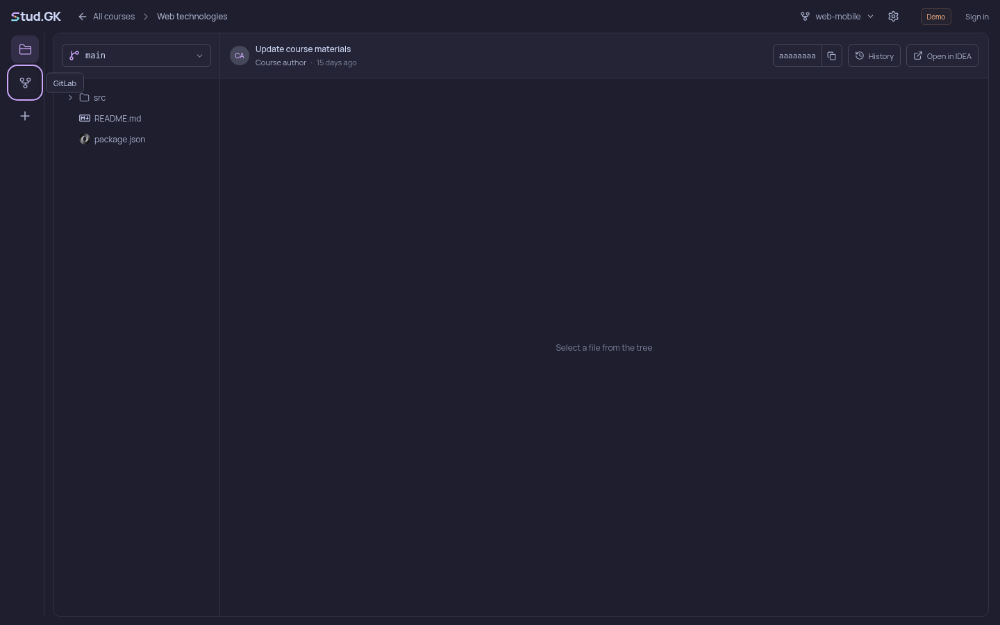
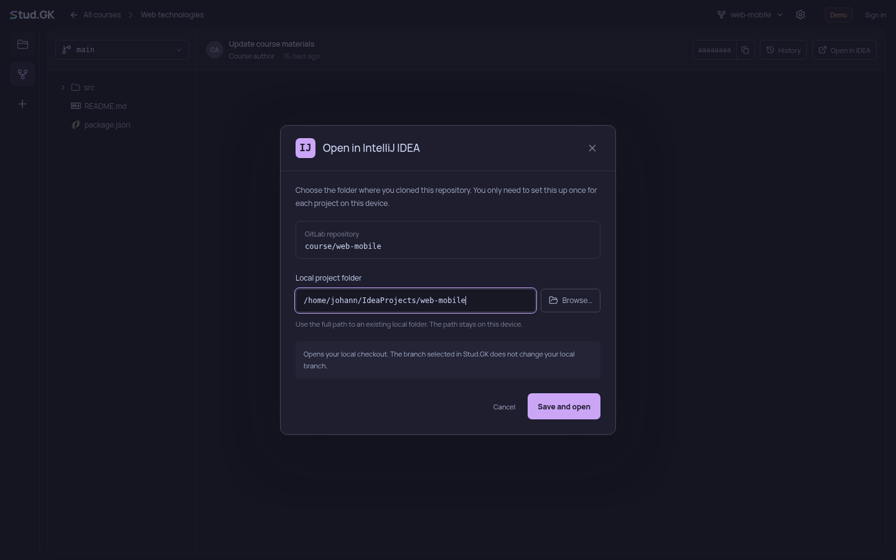
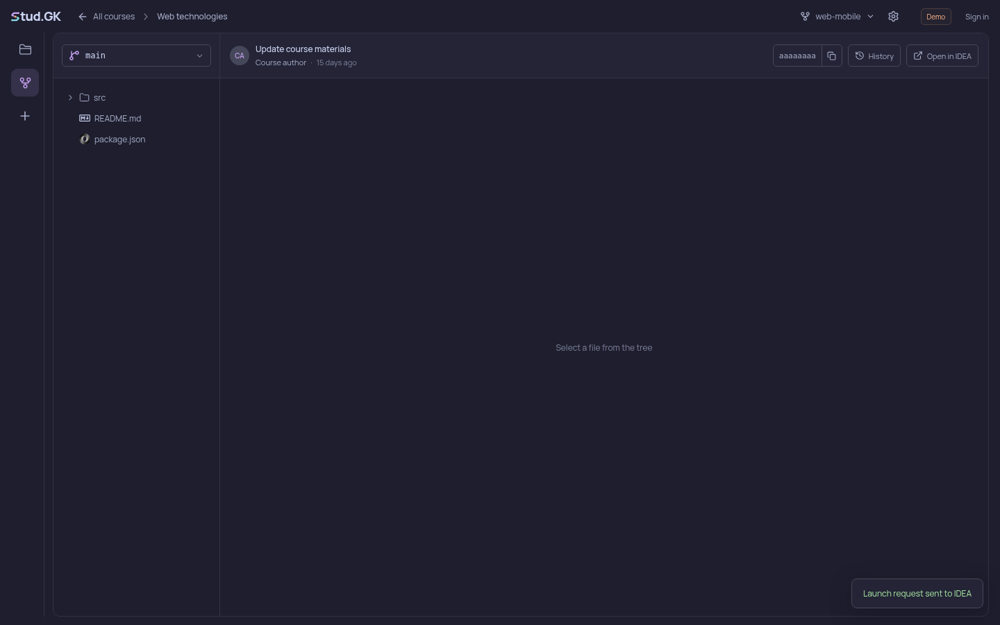
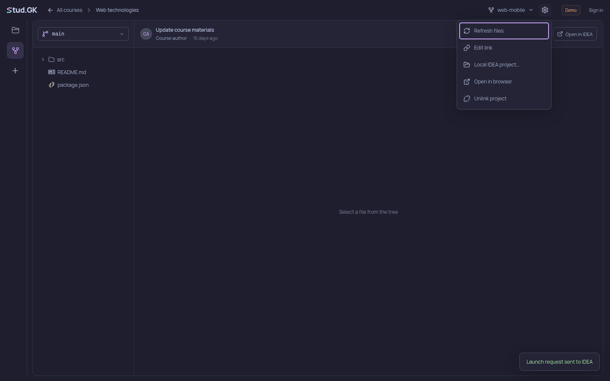

# Open in IDEA

The desktop app asks for the local checkout folder once per GitLab repository. Paths stay in this device's application profile, keyed by the repository URL. The same repository uses the saved path across courses. Other repositories have separate paths.

1. Select **Open in IDEA** in the repository's commit bar.

   

2. Enter the local folder or use **Browse…**, then select **Save and open**.

   

3. Later clicks send the launch request immediately, using the saved folder.

   

4. Use **Local IDEA project…** in the GitLab settings menu to change the folder.

   

These are captures of the actual Electron UI with demo repository data. The smoke test replaces the IDEA launcher and folder picker, so it does not start or alter a developer's IDE. The path shown in the setup capture is an example. The test uses a temporary folder for launches.

To reproduce after `npm ci` and `npm run build`:

```sh
CAMPUS_IDEA_SCREENSHOTS="$PWD/docs/pr/open-in-idea" \
  xvfb-run -a npm run test:idea -- --no-sandbox --ozone-platform=x11
```

The native handler accepts an existing absolute directory and starts a fixed IDEA launcher with the directory as a single argument, without a shell. It accepts requests only from the local app's main frame. It does not clone repositories or switch branches. The launcher must be installed separately and available to the application. The confirmation reports that the launch request was sent, rather than claiming the IDE finished opening.
